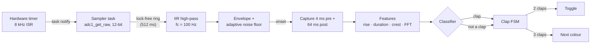
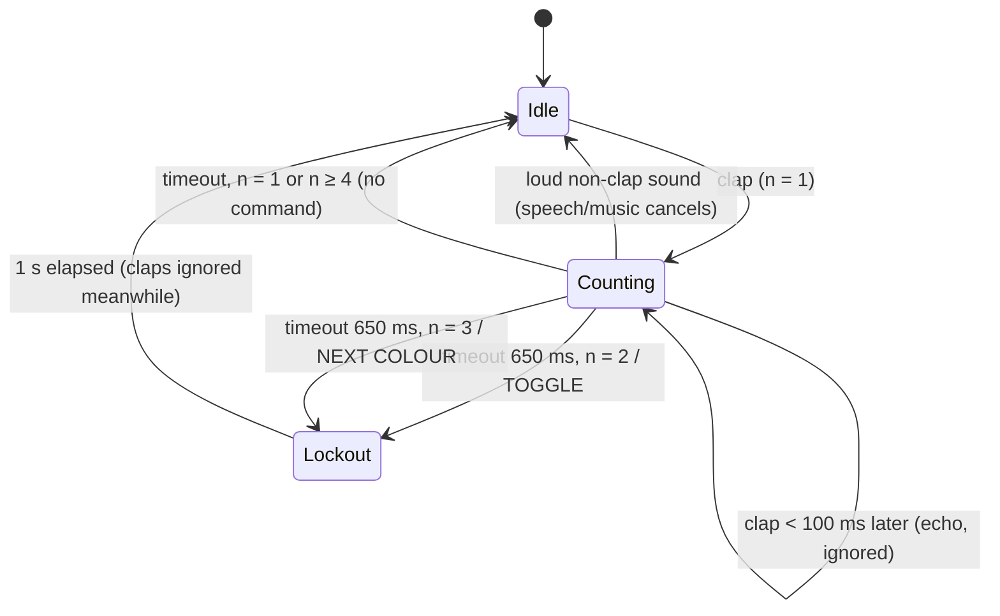

# Clap-Activated Smart Lamp

**ESP32 · C++ · DSP** — Kappa Theta Pi new member project

An ESP32 RGB lamp that **toggles on a double clap** and **cycles colours on a
triple clap**. It doesn't use a simple loudness threshold. It classifies each
sound from its shape, so talking, music, a dropped book or a door doesn't
switch the light.

- **Sampling:** an analog microphone module is read at **8 kHz** by the ESP32's
  **12-bit ADC**, paced by a **hardware-timer interrupt**.
- **Filtering:** a **first-order IIR high-pass filter** (fc = 100 Hz) removes
  the ADC's DC offset and low-frequency noise (mains hum, rumble, handling).
- **Classification:** each sound is scored on **envelope rise time, pulse
  duration, peak-to-RMS ratio and FFT spectral content** (centroid and
  high-band energy).
- **Clap timing:** a **finite state machine with timeout and lockout states**
  turns individual claps into commands.


---

## How it works



### 1. Sampling: timer interrupt + 12-bit ADC

Hardware timer 0 ticks at 1 MHz (80 MHz APB ÷ 80) and fires an alarm every
125 ticks, which is exactly 8 kHz. ESP32 ADC driver calls take a lock and
aren't safe inside an ISR, so the ISR only sends a direct-to-task
notification. A sampler task at priority 20 then reads `adc1_get_raw()` and
pushes the sample into a lock-free single-producer/single-consumer ring
buffer. Each timer tick adds one to the notification count, so if a read ever
falls behind, the count is above one and the firmware records a **missed
tick**. The serial stats line reports the measured sample rate, missed ticks
and ring overflows every 10 s.

8 kHz gives a 4 kHz Nyquist limit, which covers where most of a clap's energy
sits (≈1–3 kHz).

### 2. First-order IIR high-pass filter

The microphone output sits at about half the supply voltage, around 2048
counts, plus drift, hum and rumble. A one-pole, one-zero high-pass filter
removes all of that:

```
y[n] = a · ( y[n-1] + x[n] − x[n-1] )        a = RC / (RC + T)
H(z) = a (1 − z⁻¹) / (1 − a z⁻¹)             RC = 1 / (2π·fc),  T = 1/8000 s
```

With fc = 100 Hz, a = 0.9272. The zero at z = 1 gives exactly zero gain at
DC. The response is −3 dB at 100 Hz and −7 dB at 50 Hz, and 0.962 (−0.3 dB)
across the clap band. The unit tests check the analytic response, the DC
removal and the measured sine amplitude.

### 3. Onset detection

- **Envelope:** instant attack with a 4 ms release.
- **Noise floor:** asymmetric smoothing. It rises slowly (τ = 2 s), so claps
  barely move it, and falls quickly (τ = 150 ms) when the room goes quiet.
- **Trigger:** the envelope must exceed 8× the noise floor (18 dB) and an
  absolute minimum. In a loud room the trigger rises with the noise.
- **Capture:** each event records 4 ms of pre-trigger audio from a ring buffer
  plus 64 ms after the trigger.
- **Re-arm:** after an event, the envelope must drop back below 70 % of the
  trigger before another event can start, so a clap's own reverb tail can't
  count as a second clap.

### 4. Features

| Feature | How it's measured | Clap | Speech / music |
|---|---|---|---|
| **Rise time** | 10 → 80 % of peak on a 2 ms-release envelope | < 3 ms | 10–40 ms (vowel onsets, note attacks) |
| **Pulse duration** | onset until the envelope has stayed below 25 % of peak (−12 dB) for 25 ms | 5–40 ms | 80 ms+ (syllables, notes) |
| **Peak-to-RMS** (crest factor) | over the 68 ms capture window | 6–13 | 2–4 |
| **Spectral centroid** | 256-point FFT, Hann window, first 32 ms, 150 Hz–4 kHz | 1.2–2.5 kHz | mostly < 1 kHz for voiced sound |
| **High-band ratio** | energy 1–4 kHz ÷ energy 150 Hz–4 kHz | > 0.6 | low for vowels and most notes |

The 25 ms hold in the duration measurement matters. A plosive ("t", "k",
"p") starts with a short, clap-like burst, but its vowel follows within a few
tens of ms. The hold keeps the vowel in the same event, so it fails the
duration and rise-time checks.

### 5. Classifier

Rise time and duration are **hard gates**: an impulse has to be fast and
short. Crest factor, centroid and high-band ratio are **soft gates**, and at
least 2 of the 3 must pass. A single odd reading (for example a clap close to
a wall, with less high-frequency energy) can't veto a clap, and a single
clap-like reading can't accept a low thump. All thresholds are in
`ClassifierConfig` in [`lib/ClapDSP/src/clap_dsp.h`](lib/ClapDSP/src/clap_dsp.h).

### 6. Clap-timing state machine



- **Timeout:** the FSM can't know a double clap is finished until no third
  clap arrives. It waits 650 ms after the last clap and then fires.
- **Four or more claps fire nothing.** Applause and drum beats are rhythmic
  claps, not commands.
- **Any non-clap sound in the middle of a pattern cancels it.** This is what
  stops music with hi-hats and snares from false-triggering. Percussion is
  almost never alone, so the melody or vocals cancel the pattern.
- **Lockout:** for 1 s after a command, claps are ignored, so the clap you
  just made, or someone repeating it, can't immediately undo the change.

---

## Hardware

| Part | Notes |
|---|---|
| ESP32 DevKit (ESP32-WROOM-32) | |
| Analog microphone module | MAX9814 (best: built-in AGC), MAX4466, or KY-037 using its **AO** pin |
| RGB LED, common cathode | or a 12 V RGB strip through 3 logic-level N-MOSFETs (e.g. IRLZ44N) |
| 3 × resistors | ~150 Ω (R), ~100 Ω (G, B) for a 20 mA LED at 3.3 V |

| Signal | ESP32 pin |
|---|---|
| Mic OUT / AO | **GPIO 34** (ADC1_CH6; ADC2 pins don't work while Wi-Fi is active) |
| Mic VCC / GND | 3.3 V / GND |
| LED red / green / blue | GPIO 25 / 26 / 27 (through the resistors or MOSFET gates) |
| LED common cathode | GND (set `LED_COMMON_ANODE = true` for a common-anode LED on 3.3 V) |
| Status LED | GPIO 2 (on-board): blinks on every detected clap |
| BOOT button | GPIO 0: press = toggle, hold 1 s = next colour |

Pins and timing are in [`include/config.h`](include/config.h).

---

## Build and flash

```bash
git clone https://github.com/IanL1COMPENG/Clap-Activated-Smart-Lamp.git
cd Clap-Activated-Smart-Lamp
pio run -t upload
pio device monitor        # 921600 baud
```

Every sound the lamp hears is logged with its features and verdict:

```
[sound] t= 12.481s peak= 812 rise= 0.62ms dur=  8.1ms crest= 8.40 centroid=1790Hz hf=0.83 -> CLAP
[sound] t= 12.802s peak= 760 rise= 0.88ms dur=  9.4ms crest= 7.95 centroid=1702Hz hf=0.80 -> CLAP
[lamp] TOGGLE -> on, warm white
[sound] t= 15.110s peak= 455 rise=18.25ms dur=142.0ms crest= 3.02 centroid= 640Hz hf=0.21 -> noise [rise long crest centroid hf]
[stats] 8000 samples/s, missed ticks 0, ring overflows 0, noise floor 6.2, trigger 100
```

Use this log to tune thresholds for your microphone and room. The lamp also
saves its on/off state and colour to flash.

---

## Measuring detection accuracy

`tools/clap_eval.cpp` runs **the same `clap::Pipeline` the firmware runs**
over WAV clips and scores it.

```bash
g++ -std=c++17 -O2 -I lib/ClapDSP/src tools/clap_eval.cpp -o clap_eval
```

### On your own recordings (the real test)

Record clips with the lamp's microphone or a phone, in the room the lamp will
live in, and sort them into folders:

```
data/double/     clips with one double clap         -> must produce TOGGLE
data/triple/     clips with one triple clap         -> must produce NEXT_COLOR
data/negative/   speech, music, TV, podcasts, ...   -> must produce nothing
```

Any WAV format works: 8/16/24/32-bit PCM or float, any sample rate, mono or
stereo. Clips are band-limited, resampled to 8 kHz and scaled into ADC counts,
like the microphone module and ESP32 ADC would see them.

```bash
./clap_eval --data data --csv events.csv
```

It prints every clip that failed, then the totals:

```
Clap patterns correctly detected: ... / ...
False triggers on speech/music:   ... command(s) in ... of ... clips
```

`events.csv` has the features of every detected sound, which is useful for
plotting clap and non-clap clusters and moving thresholds. Use `--gain` to
match your recording level to the mic module's (full scale = ±gain ADC
counts, default 1500).

| Test set | Clips | Result |
|---|---|---|
| Double + triple claps | | % correctly detected |
| Speech + music | 200 | false triggers |

*(Fill in from your `clap_eval --data` run.)*

### On synthetic clips (regression test, runs in CI)

```bash
./clap_eval --synthetic --seed 2050
```

This generates 100 clap-pattern clips and 200 negative clips with
[`tools/synth.h`](tools/synth.h):

- **Claps:** band-limited noise bursts with 0.2–0.9 ms attack and room reverb
  (RT60 0.2–0.6 s).
- **Speech:** formant speech with plosives and fricatives.
- **Music:** chords, piano-like attacks, pads, and drum kits with kick, snare
  and hi-hats.
- **Mic and ADC model:** DC bias, 50/60 Hz hum, noise and 12-bit quantisation.

Results with the current thresholds:

| Seed | Clap patterns detected | False triggers (200 speech/music clips) |
|---|---|---|
| 2050 | 97 / 100 | 0 |
| 7 | 97 / 100 | 0 |
| 99 | 94 / 100 | 0 |

Synthetic audio is cleaner than a real room, so treat these numbers as a
regression check. Your recordings are the real accuracy test.

---

## Tests and CI

```bash
pio test -e native    # 18 Unity tests: filter response, FFT, classifier, every FSM path, end-to-end
pio run -e esp32dev   # firmware
```

GitHub Actions runs the unit tests, builds the firmware, builds `clap_eval`
and runs the synthetic evaluation on every push. The firmware binary and the
evaluation report are uploaded as build artifacts.

## Project layout

```
lib/ClapDSP/src/clap_dsp.h   high-pass, FFT, detector, features, classifier, FSM (shared by all)
src/sampler.cpp              hardware-timer ISR + 12-bit ADC sampler task + ring buffer
src/main.cpp                 DSP task, logging, button, wiring it together
src/lamp.cpp                 RGB PWM, gamma, cross-fades, palette, NVS persistence
include/config.h             pins, sample rate, LED settings
tools/clap_eval.cpp          accuracy evaluation on WAV folders or synthetic clips
tools/synth.h                synthetic claps / speech / music generator
test/test_clap_dsp/          Unity tests
```
